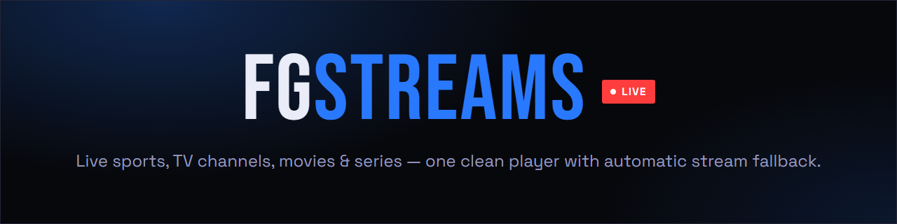
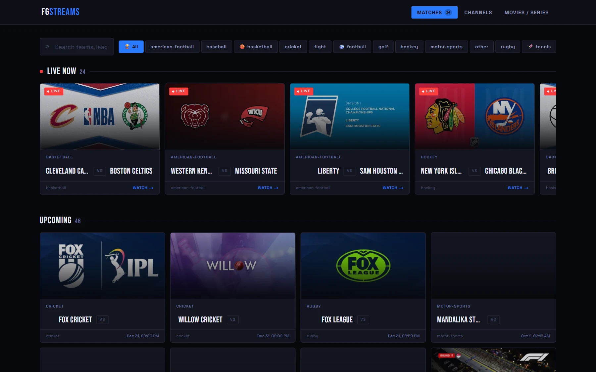
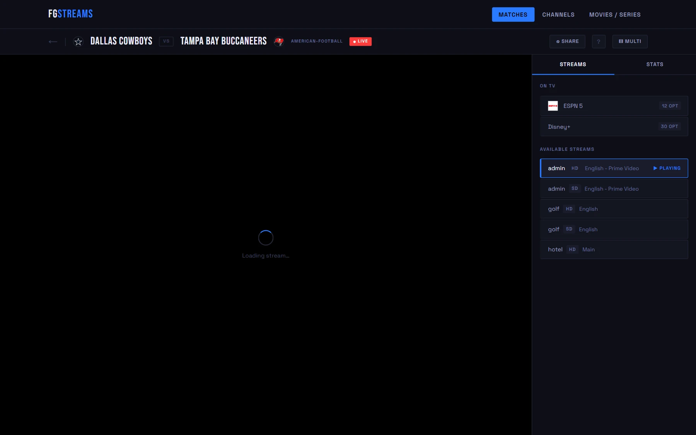
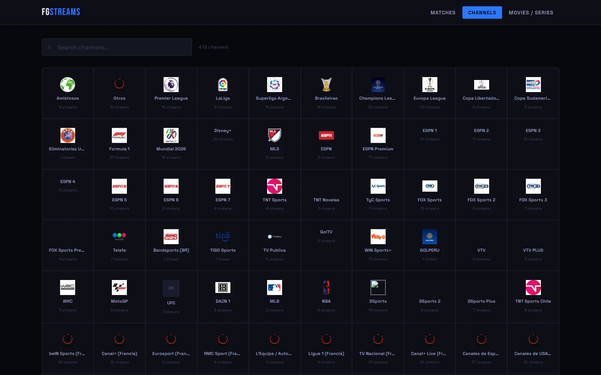
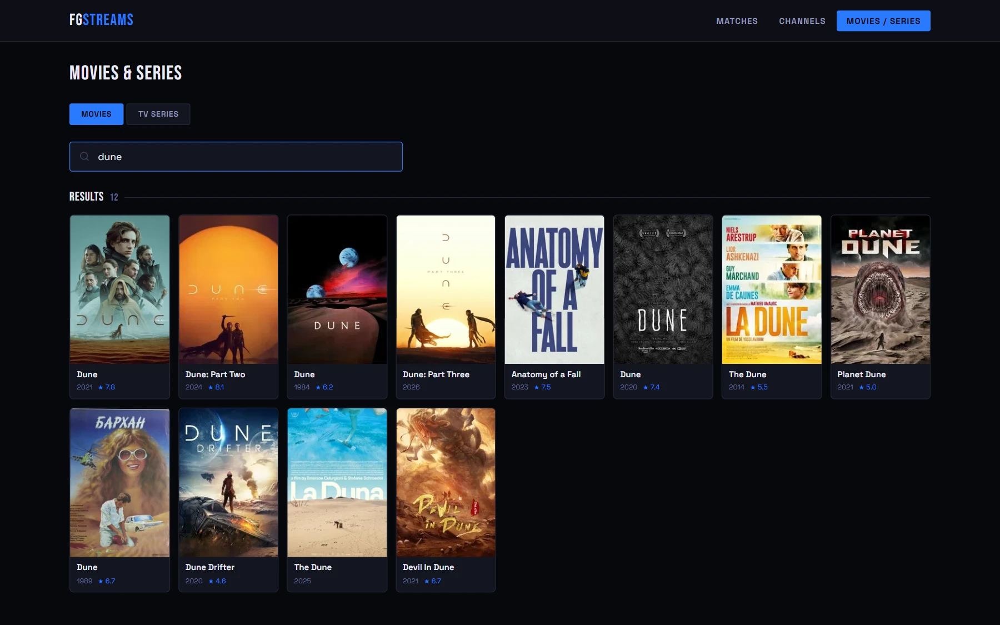
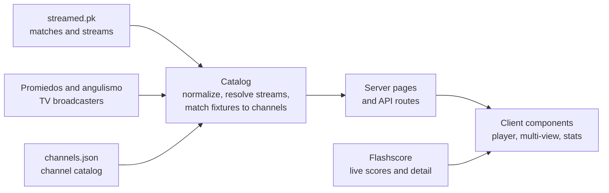

<div align="center">



<br>

[](https://github.com/fedegualdrini/fgstreams3/actions/workflows/ci.yml)
[](LICENSE)
[](https://nextjs.org)
[](https://www.typescriptlang.org)
[](https://tailwindcss.com)

**[Live demo](https://fgstreams3.vercel.app)** · [Architecture](docs/ARCHITECTURE.md) · [Project structure](docs/PROJECT_STRUCTURE.md) · [Contributing](.github/CONTRIBUTING.md)

</div>

---

FGStreams lists what is live right now, finds a playable source for it, and keeps playing when a source fails. Matches, TV channels, and movies and series share one fast, clutter-free interface.

<p align="center">
  
</p>

## Features

| | |
|---|---|
| **Only matches you can watch** | Stream endpoints are resolved server-side before render. A match with no working stream and no TV channel carrying it is never listed. |
| **Automatic stream fallback** | When a stream fails to load, the player rotates to the next untried one. If all fail, **Try Again** refetches. The best stream is picked by language, quality and source order. |
| **TV channel detection** | Fixtures are matched against [Promiedos](https://www.promiedos.com.ar) and the angulismo feed to find the broadcaster, then resolved against the local channel catalog (ESPN Premium, TNT Sports, ...). The channel shows as a playable source and a badge on the card. |
| **Multi-match view** | Watch up to four matches at once, with per-stream mute, remove and source switching. |
| **Live scores and stats** | Polled scores and minute on cards. Match pages add events, statistics and lineups when available (Flashscore-backed). |
| **Search and filters** | Filter by team, league or sport, with quick sport buttons. |
| **Watch history** | Recently watched matches are kept in local storage and shown on the home page. |
| **Channels** | A searchable catalog of hundreds of channels. The selected channel and source live in the URL, with retry and next-option controls. HLS and DASH (ClearKey) play natively. |
| **Movies and series** | TMDB-backed search, embedded playback, and season/episode selection for TV. |
| **Keyboard shortcuts** | `N` next stream, `R` reload the player, `F` fullscreen, `?` shortcut help. |

## Screenshots

<table>
  <tr>
    <td width="33%"><a href="docs/screenshots/match.webp"></a></td>
    <td width="33%"><a href="docs/screenshots/channels.webp"></a></td>
    <td width="33%"><a href="docs/screenshots/movies.webp"></a></td>
  </tr>
  <tr>
    <td align="center"><sub><b>Match page</b>: TV channels and fallback sources</sub></td>
    <td align="center"><sub><b>Channels</b>: searchable catalog</sub></td>
    <td align="center"><sub><b>Movies &amp; series</b>: TMDB search</sub></td>
  </tr>
</table>

## Quick start

Requires Node.js 20.19+ (22 recommended).

```bash
git clone https://github.com/fedegualdrini/fgstreams3.git
cd fgstreams3
npm install
npm run dev
```

Open [http://localhost:3000](http://localhost:3000).

### Environment

Sports matches and channels need no configuration. Create `.env.local` for the rest:

```bash
TMDB_API_KEY=your_tmdb_api_key          # movie and TV search
HLS_PROXY_SECRET=any_long_random_string # signs the URLs /api/hls-proxy hands back
```

Set `HLS_PROXY_SECRET` in production so nobody else can produce valid proxy signatures.

### Commands

| Command | What it does |
|---|---|
| `npm run dev` | Start the development server |
| `npm run build` / `npm start` | Build and serve the production app |
| `npm test` / `npm run test:watch` | Run the Vitest suite once / in watch mode |
| `npm run lint` | Next.js linting |
| `npm run typecheck` | `tsc --noEmit` |
| `npm run import:playlist -- <playlist.json>` | Merge an external channel playlist ([guide](docs/CHANNEL_IMPORT.md)) |
| `npm run optimize:logos` | Download and shrink channel logos into `public/logos/` ([guide](docs/CHANNEL_IMPORT.md)) |

### Direct playback (embed.st)

Supported `https://embed.st/embed/<source>/<id>/<stream-number>` sources start in **Direct player (HQ)** mode on match pages, multi-match cards and channel options. Use the buttons below the video to switch to **Original embed**. Eligibility follows the actual URL, not the source label: a Streamed.pk source qualifies when it returns a supported embed.st URL. The separate StreamTP trial is described below; other providers, ordinary HLS/DASH channels and movies retain their existing players.

Direct mode never loads the provider iframe or its ad/popup scripts. After hls.js exhausts its request-level retries, a fatal network failure triggers up to three full restarts of the **same source**, delayed by 2, 4 and 8 seconds. Each restart loads a fresh master playlist and returns to the live edge; it does not preserve DVR position. Native HLS network failures use the same recovery policy. The restart budget renews only after 60 seconds of uninterrupted playback progress, not a brief `playing` event. A reconnecting status appears while recovery is pending.

Non-network fatal errors or exhausted recovery offer **Retry direct playback** and, on match pages, **Try next stream**. Manual retry starts a fresh budget. Changing source, selecting **Original embed**, reloading or leaving the player cancels pending restarts. Direct mode never automatically opens the original embed or discards the selected source. **Original embed** is explicit opt-in and may show provider ads or popups. A different source or player reload starts with Direct mode again.

Direct HQ exposes only the rendition with the highest advertised `BANDWIDTH`; hls.js and native HLS cannot automatically downgrade to a lower rendition. Slow connections may buffer instead. Direct media resources must end on the verified HTTPS origins `p16-common-sign.tiktokcdn.com` and `p19-common-sign.tiktokcdn.com`. Media is not proxied through Vercel.

The hls.js Direct player tolerates approved CDN host/path/signature rotation for the same segment when its media sequence, discontinuity, duration, gap flag and program timestamp still match (up to 50 ms timestamp rounding). Stable playback identities are separate from the latest signed download URLs, so a rotation does not restart the player or re-download buffered segments. This is metadata matching, not a content hash; other playlist, demux and decoder checks remain enabled. Only the current playlist windows are retained, not a media cache or URL history. Untimestamped, encrypted, byte-range and low-latency playlists retain strict URL consistency; native HLS is unchanged.

Some sources, including `hotel`, hide those CDN URLs behind restricted `https://lb<number>.strmd.st/b/` gateways. The server resolves each gateway with a header-only `HEAD` request using the provider's Origin/Referer, validates its redirect destination, and puts the direct CDN URL into the playlist. It does not download the video or follow arbitrary redirect chains. If a gateway does not redirect to a verified CDN, Direct playback fails locally; retry, choose another source or explicitly select **Original embed**.

The browser sends the public embed URL to `/api/embed-st/manifest`. The server requests a fresh binary response, authenticates and decodes it, then fetches the HLS playlist in the same request context. Nested playlists repeat this process using stream-relative paths, not old signed tokens. Media segments stay direct.

The relay uses `impit` with a browser-compatible HTTP/TLS profile: the provider rejects Node's built-in `fetch` with HTTP 403 even for working signed URLs. Browser-resolved tokens also failed when fetched from Vercel, so resolution stays inside each server request. Keep optional native dependencies enabled when installing (`npm install` / `npm ci`); the matching Windows or Linux binary is required. A listed source may still be offline or rejected by the provider.

### Direct playback (StreamTP/la18hd trial)

The verified ESPN Premium source `https://la18hd.su/vivo/canales.php?stream=espnpremium` also starts in **Direct player** mode. Its observed aliases, `https://streamtp-golden1.click/global1.php?stream=espnpremium` and `https://streamtp99a.sbs/global-1.php?stream=espnpremium`, resolve through that same page. This applies to qualifying channel and match options, not every StreamTP channel or the unrelated Sensa source.

`/api/streamtp/resolve` fetches only that fixed provider HTML document, using `impit`, a 15-second deadline and a 256 KiB limit. It parses the standalone `window.CDNPEER` JSON assignment without executing provider scripts and returns a validated HTTPS ESPN Premium playlist on a `*.fubo18.com` CDN. All HLS playlists, audio and video then load directly from the CDN in the browser: no media or manifest relay, P2P trackers, service worker, provider iframe or ad scripts in Direct mode.

The shared player offers the same explicit **Original embed** choice and bounded same-source recovery. A network restart resolves a fresh URL before reconnecting. Metadata failures remain local; signed URLs are not cached, persisted or logged. Provider availability and browser/CDN restrictions can still prevent playback; there is no media-proxy fallback.

### Stream Test (experimental)

Open `/stream-test` from the main navigation to test either supported provider with the shared HLS engine. Paste a current embed.st URL or the StreamTP/la18hd ESPN Premium URL above and click **Resolve & play**. For embed.st, find current source IDs in `https://streamed.pk/api/matches/live`, then copy an `embedUrl` (or matching `url`) from `/api/streams/<source>/<id>`. Arbitrary HLS URLs and other StreamTP channels are intentionally unsupported.

Decoder, resolver-boundary, CDN-rotation and playback-mode checks: `npx vitest run lib/embedSt.test.ts lib/embedStHls.test.ts lib/streamTp.test.ts components/players/DirectPlayback.test.tsx`.


## How it works



streamed.pk, Promiedos and the angulismo feed are combined into one cached catalog (`lib/catalog.ts`), then served to the pages and API routes. Only the match feed is mandatory: the other sources degrade to "no extra data", and an empty upstream response is never cached. See [docs/ARCHITECTURE.md](docs/ARCHITECTURE.md) for the full walkthrough.

## Tech stack

- **[Next.js 14](https://nextjs.org)** (App Router), **React 18**, **TypeScript** in strict mode
- **Tailwind CSS** plus a small set of shared CSS primitives (`.btn`, `.kbd`, `.status-panel`)
- **[hls.js](https://github.com/video-dev/hls.js)** and **[Shaka Player](https://github.com/shaka-project/shaka-player)** for HLS and DASH playback
- **[Zod](https://zod.dev)** to validate every upstream response
- **Vitest** and Testing Library for tests; GitHub Actions for CI

## Data sources

| Source | Used for |
|---|---|
| [streamed.pk](https://streamed.pk) | Matches, live flags, per-match streams, images |
| [Promiedos](https://www.promiedos.com.ar) | Fixture broadcasters, read from the page's `__NEXT_DATA__` |
| angulismotv feed | Channel catalog and fixture-to-channel mapping with playable URLs |
| Flashscore (mobile pages) | Live scores and match detail, through local API routes |
| [TMDB](https://www.themoviedb.org) | Movie and TV metadata (needs `TMDB_API_KEY`) |
| `public/channels.json` | Local channel catalog |

## Documentation

- [Architecture](docs/ARCHITECTURE.md): data flow from the upstream feeds to the screen
- [Project structure](docs/PROJECT_STRUCTURE.md): every folder and module, plus coding conventions
- [Channel import](docs/CHANNEL_IMPORT.md): merging an external playlist into the catalog
- [Contributing](.github/CONTRIBUTING.md): setup, checks and conventions

## Disclaimer

FGStreams does not host, upload or store any video content. It aggregates links and embeds that third-party services make publicly available. Whether a given stream is legal to watch depends on your jurisdiction and the source, and that is your responsibility. If you are a rights holder and want something removed, open an issue.

## License

[MIT](LICENSE)
